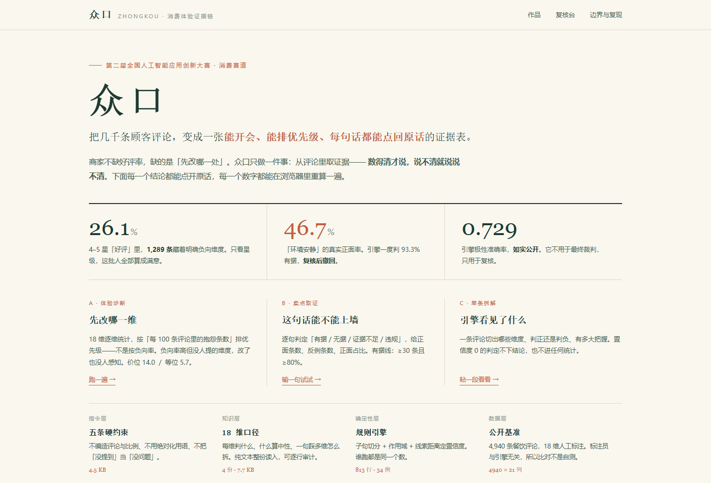

# 众口

消费体验证据链分析智能体。把几千条顾客评论，变成一张能开会、能排优先级、每句话都能点回原话的证据表。



## 这个仓库装的是什么

众口的主体不是一段可编译的程序。它是在智能体平台上用提示词、知识库和技能编排搭出来的，判断一句话是夸还是骂、讲的是口味还是卫生，这些活靠模型。

但其中一层被单独写成了代码，就是证据引擎。一个维度被提了多少次、正面多少条、负向多少条、按什么排优先级、一句宣传语够不够有据，这几件事不能靠模型凭印象数。所以这一部分有源码，能跑，能测，能复算。

仓库装的是这个智能体的全部可迁移资产：系统提示词、四份口径原文、一个确定性引擎、三条实测的完整记录，以及复现步骤。

评委或复现者打开仓库，能看到这个智能体是怎么被约束的，也能亲手跑一遍，看它数得对不对，而不只是看几张截图。

## 目录

| 路径 | 内容 |
|---|---|
| `PROMPT.md` | 系统提示词全文，可直接粘贴到一个空白智能体里运行 |
| `kb/` | 四份口径原文：18 维定义、诊断模板、卖点取证与禁用词、文案规则 |
| `engine/` | 证据引擎，18 维抽取、极性判定、诊断排序、卖点取证的确定性实现，34 个测试 |
| `data/` | ASAP 公开测试集 4,940 条（含 18 维人工标注）、数据来源卡、原许可 |
| `tests/` | 三条实测的输入、输出要点与核验结论 |
| `docs/搭建手册.md` | 从建智能体到跑通边界测试的六个步骤 |
| `docs/作品说明.md` | 完整作品文档，含背景、方法、创新点、问题与风险 |

## 它解决什么问题

一家门店一个月能攒下几百到几千条评论。运营看不过来，最后只看两个数：星级和差评截图。

星级的问题是它把不同的事压成一个数。4.8 分和 4.6 分，看不出差在哪一维。更麻烦的是 5 星里也可能藏着明确的不满——「味道不错，就是等了四十分钟」，星级给 5，抱怨是真的。

模型能读完全部评论，但它数不准。问它「有多少人抱怨等位」，十次能给十个数字，而且每个看起来都挺合理。

众口的区分点在于把「数」这一层从模型手里拿走：引擎数，模型解释；引擎给的每个数字都能复算，模型说的每句话都要挂评论编号。

三种模式共用同一套骨架，只换输出格式。

- 模式 A 体验诊断：给评论数据，出 18 维短板表，告诉你先改哪一维
- 模式 B 卖点取证：给一句想上墙的话，判「有据／无据／证据不足／违规」
- 模式 C 证据文案：给场景或人群，逐句写文案，每句挂评论编号

## 三条实测结论

| 用例 | 输入 | 输出 |
|---|---|---|
| 体验诊断 | ASAP 测试集 4,940 条 | 有明确判定 4,850 条（98.2%）；4–5 星里含明确负向 1,289 条（26.1%）；价位每百条 14.0 条抱怨居首，等位负向率 61.6% 最尖锐；另标出 9 簇重复文案共 24 条 |
| 卖点取证 | 「上菜快／环境安静／食材新鲜」三句海报语 | 环境安静判有据 93.3%，落点错到装修维度，回落到噪音维度复算 46.7%，撤回；上菜快 85.2% 可用但比例要打折；食材新鲜 86.5% 可用 |
| 证据文案 | 带老人吃饭场景（331 条，占 6.7%） | 口味 89.3%、服务态度 88.9%、装修 94.8% 可用；等位 43.2%、噪音 34.6% 一句都不能写——恰好是带老人最在意的两件事 |

第二条里有一处值得单独说明。「环境安静」引擎第一次给的是有据 93.3%，因为句子里「环境」两个字先命中了装修维度。落到噪音维度复算：正面 147 条、反例 168 条，正面占比 46.7%，近一半提到噪音的顾客在说吵。这句话贴上海报，等于拿一半顾客的反证做宣传——不违规，但涉嫌与实际不符。

三句话里引擎错了两次。这不是失误被掩盖，而是被写进了方法：引擎不用于最终裁判，只用于复核。

## 先跑一遍

不需要装任何依赖，Python 3.10 以上就能跑。这一条最省事，三十秒能看出结论对不对。

```bash
cd engine
python -m unittest discover -s tests -v          # 34 个用例
python -m zhongkou diagnose --split test --top 8 # 18 维短板，预期价位 14.0 居首
python -m zhongkou claim "环境安静，适合聊天"      # 预期判无据，46.7%
python -m zhongkou audit --split test            # 与人工标注比对，预期 0.729
```

三个命令的预期输出写在 `engine/README.md` 里。数字对不上就是环境有问题，先别急着往下看。

## 怎么复现智能体

1. 在智能体平台建一个专家，命名众口，类型选 Agent
2. 把 `PROMPT.md` 全文粘进提示词框
3. 挂技能：把 `engine/` 和 `kb/` 按 `docs/搭建手册.md` 的目录结构放进去，技能入口用 `kb/` 同级那份 SKILL 说明
4. 跑一遍 `tests/` 里的三个用例，对照输出是否吻合
5. 跑 `tests/README.md` 里的四条边界测试，重点看它会不会自己编比例
6. 换一份自己的评论表再跑，看它会不会在样本不足时说「样本不足」

详细步骤见 `docs/搭建手册.md`，引擎的设计取舍见 `engine/README.md`。

## 已知局限

- 极性准确率 0.729，不是 90%。反讽、双重否定、方言会判错，所以它不复核模型，模型反过来复核它
- 维度识别 F1 0.725，会漏判。漏判的维度只能写「未形成判定」，不能用常识补
- 「环境安静」这类词会落错维度（环境→装修，而不是噪音）。引擎没有自纠能力，纠错发生在复核环节
- 抽检发现「油腻／不油腻」被误判成卫生问题，卫生从第 3 名校正到第 6 名。报告里如实写了
- 样本是跨城公开基准集，不是某一家门店。结论用于方法演示，换上本店评论重跑才可对外说
- 评论里的「排队」既可能指等位，也可能指等上菜，两者混在一起时引擎会偏向等位
- 输入需要预先整理成 CSV，列名含评论与星级两列即可，但不做 PDF／图片评论的解析

## 用途说明

本仓库内容为人工智能应用创新大赛参赛作品，供评审阅读与复现使用。文中引用的评论原话均来自 ASAP 公开数据集，已按编号标注；涉及的商家场景为方法示例，不对应任何真实门店的经营数据。
